# 🚗 AutoElite - Luxury Automobile Platform

[](https://nodejs.org/)
[](https://expressjs.com/)
[](https://www.mongodb.com/)
[](https://jwt.io/)
[](https://github.com/)

A full-stack luxury automobile showroom, test-drive scheduling, and acquisition platform built with **Node.js, Express, MongoDB, and Vanilla Modern CSS/JavaScript**.

---

## 📸 Visual Showcase & Screenshots

### 1. 🏠 Luxury Homepage & Hero Showcase
Dynamic landing experience featuring curated luxury statistics, hero CTA banner, and featured vehicle previews.
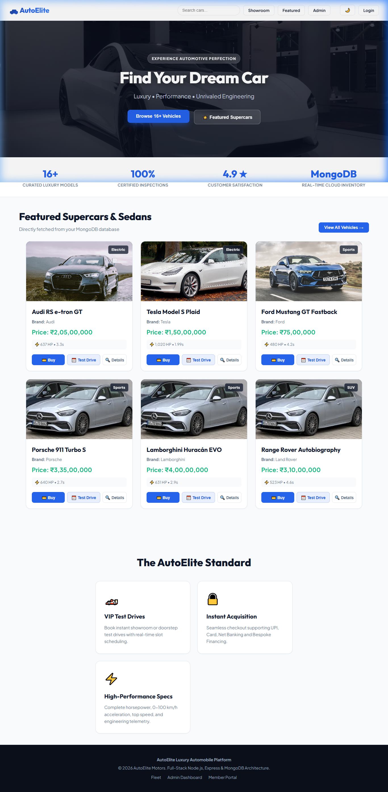

---

### 2. 🏎️ Complete Showroom Fleet (26+ Supercars & Luxury Sedans)
High-resolution vehicle cards displaying horsepower, 0–100 km/h acceleration, pricing, and category badges.
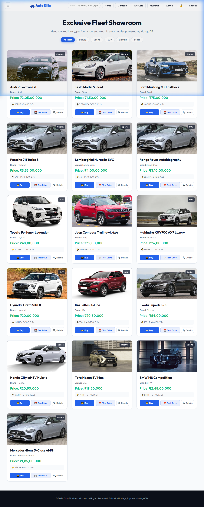

---

### 3. 🔍 Interactive Category & Dynamic Brand Filtering
Real-time filtering across **Luxury, Sports & Hypercars, SUVs, Electric (EV), and Sedans**.
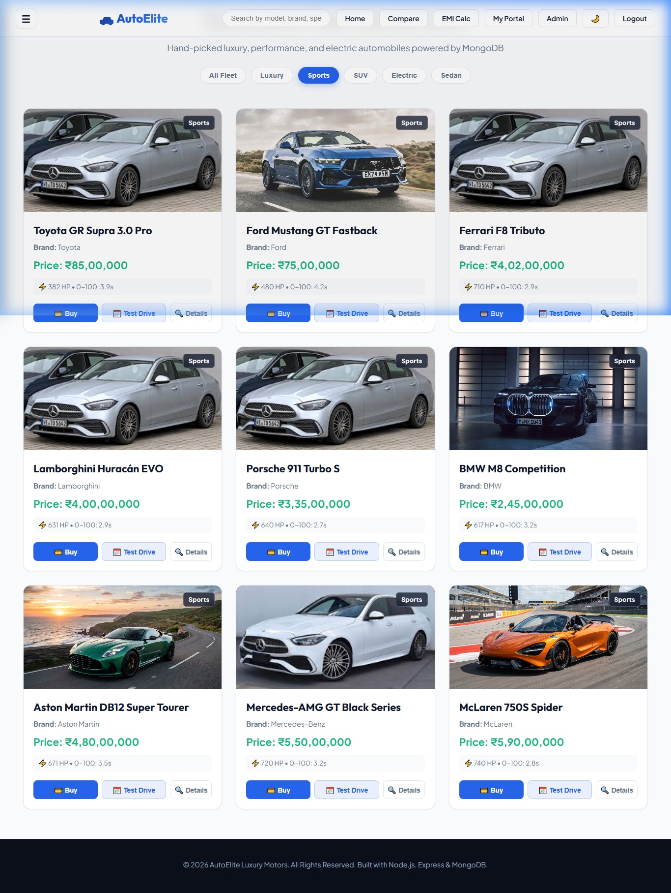

---

### 4. 🔍 Deep Vehicle Telemetry & Specifications
Detailed performance specifications including top speed, powertrain, horsepower, and direct booking actions.
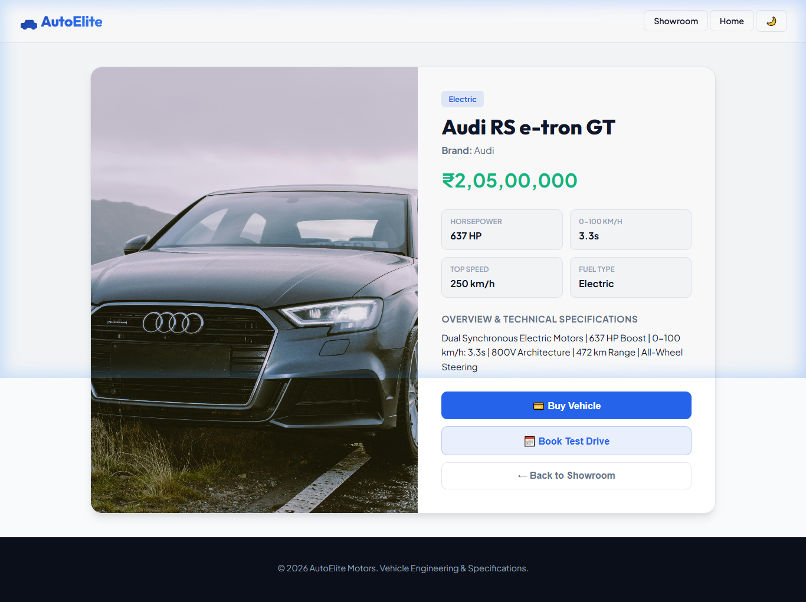

---

### 5. ⚔️ Side-by-Side Comparison Matrix
Head-to-head comparison tool evaluating pricing, power, top speed, torque, and technical highlights between any two models.
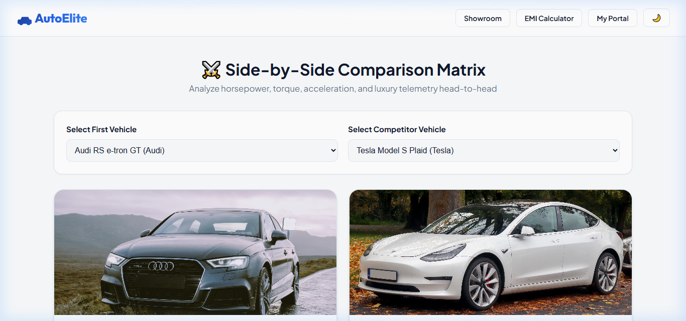
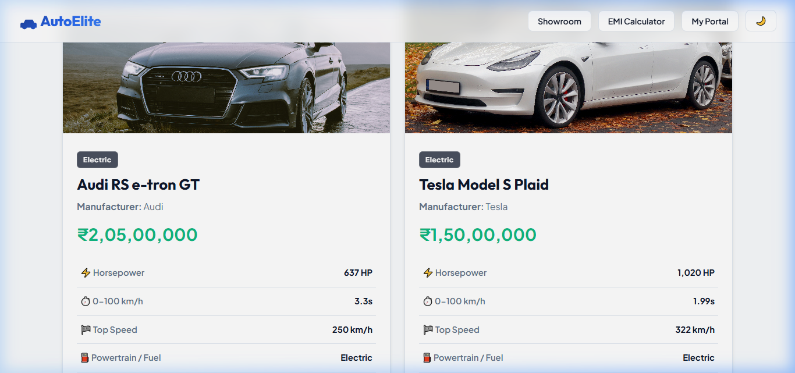

---

### 6. 🧮 Interactive Luxury EMI & Financing Calculator
Real-time loan installment calculator with customizable sliders for on-road price, down payment %, tenure, and interest rates.
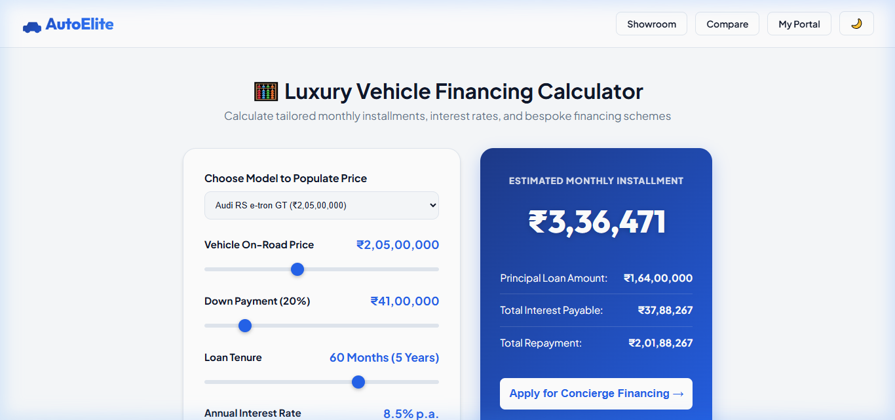

---

### 7. 📅 VIP Test Drive Calendar & Conflict-Free Slot Scheduler
Intelligent real-time appointment scheduler with calendar conflict detection and doorstep/showroom format selection.
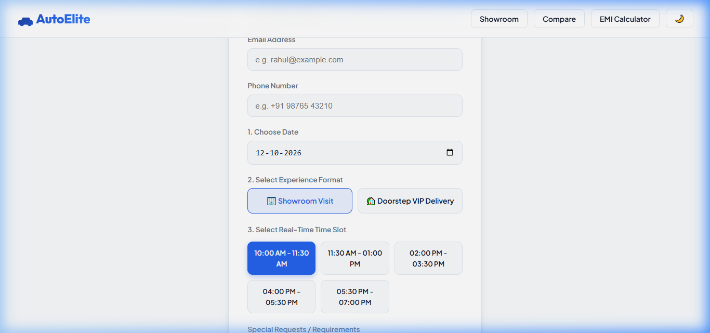

---

### 8. 🛡️ Admin Fleet Operations Center & Live Analytics
Executive management portal providing live revenue metrics, inventory table, Multer file upload, and booking status controls.
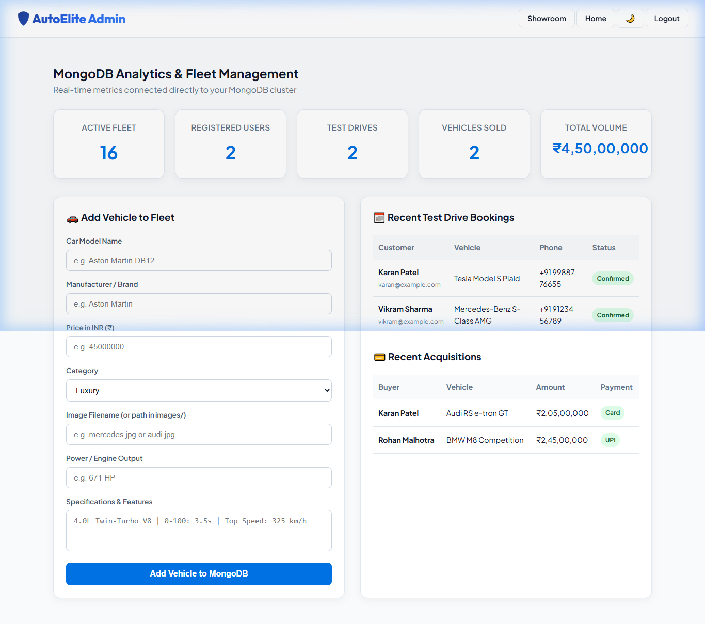
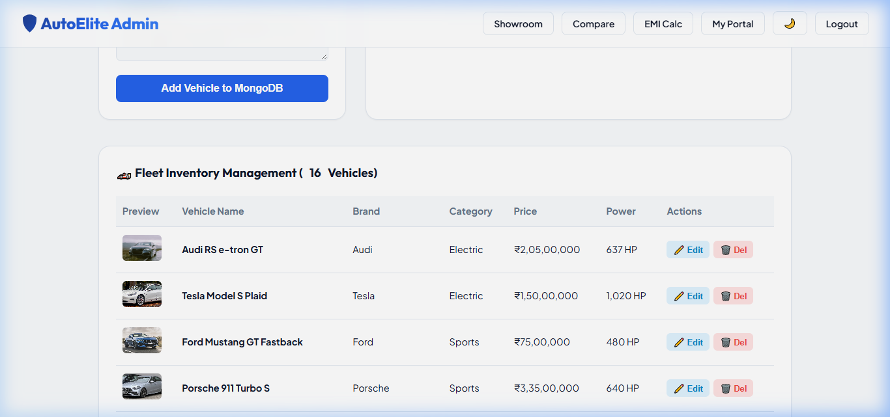

---

### 9. 📱 Offcanvas Navigation Sidebar & Theme Manager
Sleek drawer navigation with quick shortcuts, user profile status, and unified Light/Dark mode toggle with `localStorage` persistence.
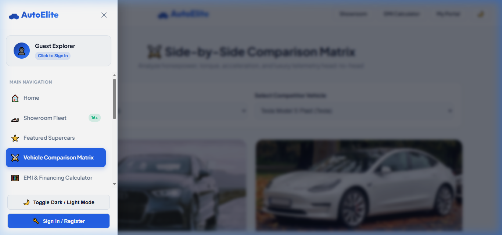

---

## 📁 Project Architecture

```text
Autoelite/
├── backend/                      # Complete Server-Side Architecture
│   ├── config/
│   │   └── db.js                 # MongoDB Mongoose connection handler
│   ├── controllers/
│   │   ├── adminController.js    # Revenue & fleet analytics aggregation
│   │   ├── bookingController.js  # Slot reservation & conflict detection
│   │   ├── carController.js      # Vehicle CRUD & multi-param filtering
│   │   ├── purchaseController.js # Transaction records & order verification
│   │   └── userController.js     # JWT auth, registration & profile management
│   ├── database/
│   │   └── seed.js               # 26 supercar models & demo account seeder
│   ├── middleware/
│   │   └── auth.js               # JWT bearer verification & admin RBAC
│   ├── models/
│   │   ├── Booking.js            # Mongoose schema for test drives
│   │   ├── Car.js                # Mongoose schema for vehicle inventory
│   │   ├── Purchase.js           # Mongoose schema for acquisition orders
│   │   └── User.js               # Mongoose schema with bcrypt hashing
│   ├── routes/
│   │   ├── adminRoutes.js        # /api/admin
│   │   ├── bookingRoutes.js      # /api/bookings
│   │   ├── carRoutes.js          # /api/cars & image upload
│   │   ├── purchaseRoutes.js     # /api/purchase
│   │   └── userRoutes.js         # /api/users
│   └── server.js                 # Primary Express server application
├── frontend/                     # Modern Vanilla Web Client
│   ├── css/
│   │   ├── auth.css              # Authentication view styling
│   │   ├── cars.css              # Showroom grid & card styles
│   │   ├── details.css           # Specification page styling
│   │   ├── purchase.css          # Checkout & payment styles
│   │   ├── sidebar.css           # Offcanvas drawer styling
│   │   ├── style.css             # Design tokens, variables & dark mode
│   │   └── testdrive.css         # Calendar scheduler styles
│   ├── images/                   # 27+ vehicle photo assets
│   ├── js/
│   │   ├── admin.js              # Admin dashboard operations
│   │   ├── auth.js               # Login & signup client logic
│   │   ├── calculator.js         # Monthly EMI loan formula engine
│   │   ├── cars.js               # Dynamic showroom loader & filters
│   │   ├── compare.js            # Dual vehicle comparison matrix
│   │   ├── darkmode.js           # Theme manager with localStorage persistence
│   │   ├── details.js            # Spec sheet renderer
│   │   ├── main.js               # Homepage featured vehicles
│   │   ├── profile.js            # Customer VIP portal & passes
│   │   ├── sidebar.js            # Offcanvas drawer component
│   │   └── toast.js              # Non-intrusive toast notification system
│   ├── index.html                # Main landing page
│   ├── cars.html                 # Showroom catalog
│   ├── car-details.html          # Vehicle spec breakdown
│   ├── featured.html             # Curated exotic fleet
│   ├── compare.html              # Head-to-head comparison
│   ├── calculator.html           # EMI financing calculator
│   ├── testdrive.html            # Test drive slot reservation
│   ├── purchase.html             # Acquisition checkout
│   ├── profile.html              # VIP customer pass & order history
│   ├── admin.html                # Operations & inventory manager
│   ├── login.html                # Account login
│   └── register.html             # Account registration
├── screenshots/                  # Curated application visual captures
├── .env                          # Environment variables (PORT, MONGO_URI, JWT_SECRET)
├── package.json                  # Scripts & npm dependencies
└── server.js                     # Root proxy entrypoint
```

---

## 🚀 Getting Started

### 1. Prerequisites
- **Node.js** (v16.0.0 or higher)
- **MongoDB** running locally (`mongodb://127.0.0.1:27017/autoelite`) or MongoDB Atlas connection URI

### 2. Install Dependencies
```bash
npm install
```

### 3. Seed MongoDB Fleet & Demo Accounts
```bash
npm run seed
```
*Populates 26 luxury vehicles with complete horsepower/0-100 metrics and demo credentials.*

### 4. Start the Application
```bash
npm start
```

Visit the application in your browser:
👉 **[http://localhost:5000](http://localhost:5000)**

---

## 🔑 Demo Accounts

| Role | Email | Password | Access Level |
| :--- | :--- | :--- | :--- |
| **Administrator** | `admin@autoelite.com` | `adminpassword123` | Full Fleet Management, Live Analytics, Inventory CRUD |
| **VIP Customer** | `vikram@example.com` | `userpassword123` | VIP Portal, Booking Passes, Order Receipts |

---

## 🌐 API Reference

### Vehicles (`/api/cars`)
- `GET /api/cars` - Fetch all vehicles (supports `?category=`, `?featured=`, `?search=`)
- `GET /api/cars/:id` - Fetch single vehicle by ID or name
- `POST /api/cars/add` - Add vehicle to fleet (Admin)
- `POST /api/cars/upload` - Multer multipart image file upload
- `PUT /api/cars/:id` - Update vehicle specifications (Admin)
- `DELETE /api/cars/:id` - Remove vehicle from database (Admin)

### Bookings (`/api/bookings`)
- `GET /api/bookings/slots?date=YYYY-MM-DD` - Real-time slot availability
- `POST /api/bookings` - Reserve VIP test drive appointment
- `GET /api/bookings` - List all bookings
- `PATCH /api/bookings/:id/status` - Update status (Confirmed / Completed / Cancelled)
- `DELETE /api/bookings/:id` - Cancel test drive reservation

### Users & Auth (`/api/users`)
- `POST /api/users/register` - Create account & receive JWT
- `POST /api/users/login` - Authenticate & receive JWT
- `GET /api/users/profile` - Authenticated profile with bookings & purchases
- `PUT /api/users/profile` - Update customer name & phone

### Purchases (`/api/purchase`)
- `POST /api/purchase` - Submit order & issue reference transaction ID
- `GET /api/purchase` - View order acquisition history

### Analytics (`/api/admin`)
- `GET /api/admin/analytics` - Revenue metrics, inventory totals, and recent activity logs

---

## 📄 License
This project is licensed under the ISC License.
